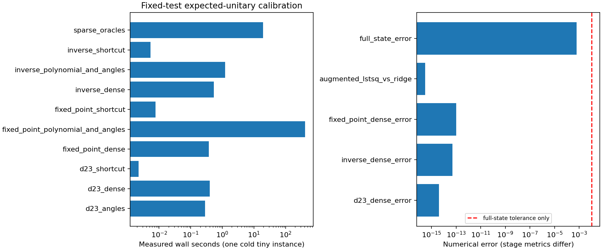
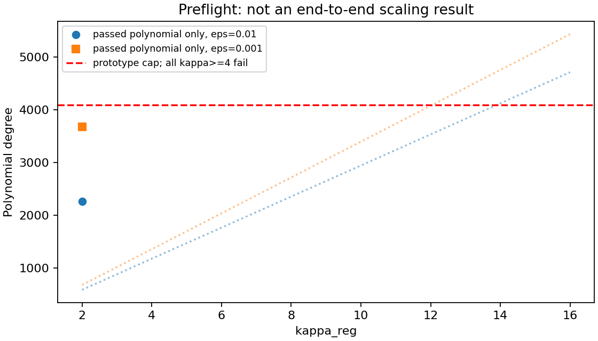

# Phase (b): verification, tiny calibration and approval report

Date: 2026-10-19. Base commit: `aa252fa`.
**The tiny fixed-test calibration passes. Full Phase (b) sweeps are not ready
and have not been launched.** The current conservative phase-finding path also
exceeds the three-hour planning budget under either extrapolation scenario below.

Implementation plan: [PHASE_B_PLAN.md](PHASE_B_PLAN.md).
Numerical results use the exact label **simulation (expected-unitary QOS,
reference convention)**. Runtime/RSS are measured classical simulation costs;
query and sample counts are calculated quantities, not hardware execution.

## Repository verification

- Working tree was clean at the requested `aa252fa`.
- `AGENTS.md`, `PLAN.md`, `N_DEPENDENCE.md`, phase-(a) code/tests, re-validation,
  calibration and run manifests were inspected. Artifact hashes match for
  phase-(a), N128, phase-1 re-validation and re-timing.
- Upstream checkout is clean at `a3fe8d6fe777750749f5e90131180e016088bdaf`.
  JAX 0.8.1, pyqsp 0.2.0, NumPy 2.3.5 and SciPy 1.16.3 match the isolated environment.
- All prior prerequisite numerical work is present. There was no completed
  augmented quantum ridge solver, reusable shadow readout or full stochastic
  end-to-end test to inherit. The reference real-data SVM scripts run classical
  Ridge pipelines; their accuracy plots do not supply those correctness gates.
- The explicit-sampling index routine hard-codes degree 51 and unverified
  PolySign. It cannot be used unchanged as the primary verified-sign path.
- CFPB TF-IDF is registered as a validated reconstructed matrix, not an on-disk
  frozen matrix. Verified export and derived-object registration remain toy preflight work.

## What the paper verification changes

The formula in the request matches F61 of [version 2](https://arxiv.org/pdf/2604.07639v2),
Theorem F.13. Exact definitions and the query derivation are in the plan, citing
PDF equations F46–F104 and D.23. Two limitations are essential:

1. F61 describes a reusable interferometric **Clifford-shadow** model. Its
   logarithmic dependence on m and uniform sparse-test guarantee cannot be tested
   with a one-test Hadamard measurement alone (F83/F92).
2. Its δ⁻¹ arises from replacing every X/y oracle by a δ/(6Q)-accurate sampled
   implementation, which gives M∝Q²/δ (F99–F104). Varying shots alone tests
   readout concentration, not that oracle-instantiation dependence.

The prototype therefore validates the fixed-test solver chain only. It uses
ε_BE=1e-4 as an explicit primitive setting, **not** the proof's global
δ/(6Q) allocation. It does not estimate any s, κ, γ or δ sample exponent.

## Tiny construction and correctness

Run: [`phase_b_calibration_20261019T180446Z-30cc20a2`](../../results/tightness/phase_b_calibration_20261019T180446Z-30cc20a2/).

| Measured/configured property | Value |
|---|---:|
| N = D; seed | 4; 42 |
| Maximum row / column sparsity | 2 / 2 |
| Singular values of normalized X | 1, 0.707107, 0.707107, approximately 0 |
| λ; measured κ_reg | 1/3; 2 |
| Squared normalized regularized residual | 0.4 |
| Measured margin γ; test norm; test infinity norm | 0.3; 1; 0.886669 |
| δ; solver target ε; primitive ε_BE | 0.1; 0.01; 1e-4 |
| Elementary sample budget M | 100,000,000 |
| Sign / D.23 / inverse / fixed-point degrees | 69 / 49 / 181 / 2,265 |

The new synthetic family uses signed circulant paired differences. Its exact
null direction allows λ to control κ without altering sparsity. Row/column sign
flips are correlated entry signs; this is a deliberately labelled **idealized
uniform-sparsity regime**, separate from the original phase-(a) generator.
No seed rejection or nominal-for-measured substitution occurred.

The primary pipeline is validated sparse oracles → D.23 X/2 → selector-built
Aλ/2 → odd pseudo-inverse of its adjoint → fixed-point amplification → fixed-test
Hadamard measurement. The ±1 label state is also loaded through expected-unitary
QOS. The selector uses a known I/2 branch, preserving subnormalization. Neither
classical doubling of X/2 nor free normalization of a success branch is used.

The inverse polynomial has a bounded C2 piecewise extension. Its interval error
is 1.22e-5 against η=6.25e-5; its angle-response error is 1.99e-14. This numerical
extension is **not claimed to achieve the proof-optimal inverse degree**.
Fixed-point amplification uses the theorem threshold 1/(40κ)=0.0125, rather than
its much larger observed input amplitude 0.244950. Its selected polynomial has
interval error 3.83e-7 and angle-response error 1.84e-13. Degree 2,265 is the
search's selected degree, not a proved minimum.

| Independent check | Observed error |
|---|---:|
| D.23 dense QSVT versus singular-value shortcut | 4.07e-15 |
| Inverse dense QSVT versus shortcut | 5.09e-14 |
| Fixed-point dense QSVT versus shortcut | 1.06e-13 |
| Augmented Gram identity | 7.85e-17 |
| Augmented least-squares direction versus normal-equation Ridge | 3.09e-16 |
| D.23 block versus X/2 | 5.60e-6 |
| Inverse success vector versus exact augmented target | 9.56e-7 |
| Label state versus ideal labels | 1.05e-7 |
| Full final state versus ideal weight state, including leakage | **6.25e-4 < 0.01** |
| Explicit Hadamard circuit probability versus overlap formula | 4.44e-16 |

The largest dense LCU unitarity error is 7.62e-13. Each new QSVT polynomial is
bounded on a dense grid and every angle set must reproduce it to 1e-10 or fail.
These are numerical safeguards, not formal interval-arithmetic certificates.

Clean ancilla checks pass. Dirty LCU-ancilla negative controls differ from the
target block by about 1.0–1.8; the dirty selector differs by 1.03. Dirty ancillas
are therefore not treated as valid inputs. The shortcut uses **stagewise canonical
Halmos completion**; these checks do not establish invariance for independently
changing random garbage blocks inside a nested explicitly sampled circuit.

## Readout and statistical resolution

The predicted sign agrees with exact Ridge. Ideal p(0)=0.65; simulated
p(0)=0.6499997546. With 17 shots, the exact binomial correctness probability is
**0.900620756**. Seventeen is the smallest odd shot count meeting 0.9 for this
computed signal. It is not an estimate of the smallest elementary M.

In 200 independent finite-shot repetitions, 183 were correct (0.915), with
Clopper–Pearson 95% interval **[0.8674, 0.9497]**. This is consistent with the
exact binomial model, but the interval does not certify success ≥0.9. The full
sweep must use independent budget-selection and validation repetitions and
report confidence-bound threshold failures. This single-test label check is
not dataset classification accuracy; balanced accuracy is not defined here.
Both ordinary and balanced accuracy are required for the proposed CFPB toys.

## Measured timing and degree preflight

- Cold end-to-end calibration: **441.54 s = 7.36 minutes**.
- Peak sampled process RSS: **0.795 GiB**, sampled every 50 ms.
- Fixed-point polynomial/angle setup: **413.44 s (93.6% of total)**.
- Sparse-oracle construction, including first-use setup: 19.34 s.
- Inverse polynomial/angle setup: 1.23 s.
- Dense D.23/inverse/fixed-point checks: 0.40 / 0.54 / 0.38 s.
- Inverse/fixed-point shortcut evaluation: 0.0054 / 0.0077 s at N=4.



A separate inexpensive polynomial-only preflight did **not** construct phases
or run prediction sweeps:

| κ_reg | ε=0.01 | ε=0.001 |
|---|---|---|
| 2 | bounded candidate at degree 2,265 | bounded candidate at degree 3,673; angles untested |
| 4 | no passing candidate found by the search below cap 4,095 | same |
| 8 | no passing candidate found by the search below cap 4,095 | same |
| 16 | starting degree 4,711 already exceeds cap | starting degree 5,433 exceeds cap |

These failures are retained. They do not prove that no lower-degree polynomial
exists. The capped search itself is inadequate for the proposed grid.



Dotted curves show the search's starting degrees; markers show candidates that
passed polynomial checks. They are not measurements of successful large-κ circuits.

## Conditional full-grid budget: exceeds approval threshold

The proposed one-factor grid has 13 unique configurations, five seeds and two
precision settings: 130 configurations, or **1,040** evaluations on an eight-point
M grid, before refinements, N128 spots, toys and stochastic validation. There are
13 distinct (κ, actual solver ε) phase sets after sharing compatible setup.

The forecast caches each phase set once. It scales degree linearly with κ and
interpolates degree versus log precision from the two κ=2 polynomial preflights.
It then scales the measured 413.44 s phase setup as degree squared or cubed,
reflecting the implementation's nested Jacobian loops and dense linear solve.

| Component/scenario | Calculated wall-time forecast, one process |
|---|---:|
| Fixed-point setup, degree-squared scenario | **40.33 hours** |
| Fixed-point setup, degree-cubed scenario | **374.80 hours** |
| 1,040 sparse-oracle builds, using frozen N64 phase-(a) median timings at ε_BE=1e-4 | 0.60 hours |

These are **conditional extrapolations, not confidence bounds or measured large-κ
runtimes**. The predicted large degrees exceed the present cap. The table excludes
higher-precision sparse oracles, other inverse setups, shadow processing, explicit
sampling, N128 and toys. Therefore no validated finite bound for the full required
Phase (b) runtime is available yet. Even the optimistic unchanged-code setup scenario
is far above three hours; no complete sweep should be authorized on this implementation.
Vectorized or analytic phase construction could change the forecast substantially.

Machine-readable assumptions and per-phase estimates are in
[`runtime_forecast.json`](../../results/tightness/phase_b_calibration_20261019T180446Z-30cc20a2/diagnostics/runtime_forecast.json).

## Calculated query/sample accounting

For a conservative explicit controlled-branch recipe, let d_s,d_A,d_I,d_F be the
sign, D.23, inverse and fixed-point degrees, and n=log₂N. The phase-(a) sparse
sample-block count is c_B=2n d_s+2. The index sine and real-part constructions give
8n d_s+4 elementary circuit branches across both index oracles and the two element
uses. Each new QSVT stage has two controlled Hermitianization branches and two
real-part LCU branches. Each real-part LCU adds one clean ancilla.

Under this stated recipe:

- X-block branch applications per prepared output: 16 d_F d_I = 6,559,440;
  label-preparation branch applications: 4 d_F = 9,060.
- Each D.23 call has 4 d_A = 196 sparse-block branch applications.
- With reference-permitted sharing across paired conjugate branches, independent
  elementary sample blocks per output are d_F(d_I d_A c_B+1) = 5,584,545,495.
  Subsequent logical uses require fresh sample blocks.
- At the deliberately high calibration M and 17 shots, the resulting calculated
  sample total is 9.4937e18. The separately reported no-conjugate-sharing recipe
  gives 2.4217e21. Neither is a minimized budget, theorem prefactor, measured draw
  count or hardware resource estimate.
- Row-sample-equivalent passes = total draws/N = 2.3734e18 under reference sharing.
  X nonzero-entry-equivalent passes = X draws/nnz(X) = 1.1867e18. Here Ns=nnz=8;
  the two pass conventions must not be conflated.

The recurrence is calculated for the stated conservative circuit recipe. A
literal nested-circuit trace and stochastic correlation audit remain necessary
before treating it as certified end-to-end accounting. Dense canonical surrogate
calls are not executions of those trillions of elementary operations. The prior
phase-(a) accounting and saved outputs remain untouched.

## Questions resolved and unresolved

| Question | Status after this gate |
|---|---|
| Correct augmented normalization and inverse direction? | Passed on tiny instance, independent exact Ridge/least-squares checks |
| Dense QSVT/LCU and clean-ancilla shortcut agreement? | Passed for the three new stages under canonical completion |
| Finite-shot sign prediction? | Analytic binomial agreement; empirical interval consistent, not a ≥0.9 certificate |
| Full s⁷ / κ⁴ / γ⁻⁴ / δ⁻¹ scaling? | **Unresolved; no sweeps run** |
| γ⁻³ versus γ⁻⁴, log(1/δ) versus 1/δ? | **Unresolved; no full explicit-sampling cross-check** |
| Reusable shadow model and m dependence? | Not implemented; Hadamard calibration cannot answer this |
| Sampled changing-garbage nested circuit? | Not validated; no stochastic channel claim |
| CFPB rare versus common columns? | Toy construction/export and padded-slot sampler still pending |

## Validation, provenance and approval options

The 167 pre-existing data/result/test/notebook files inventoried before the work
are byte-identical, including Bank and all phase-(a)/N128 artifacts. The ledger's
old bytes are an exact prefix; two calibration rows were appended. No main
environment, shared `src/`, reference code, Bank notebook or data file changed.

The run preserves exact source snapshots and their hashes. After it started,
a small fail-fast guard was added for a polynomial starting degree above the cap;
the archived calibration used the saved pre-guard source. This change does not
affect the calibrated κ=2 path. Diagnostic provenance records the subsequent
source version and the downloaded version-2 paper HTML hash. Prior result files
were not rewritten. The existing scientific regression procedure is not triggered
because no shared source/environment changed; isolated tests are recorded below.

Validation: **67 isolated tests passed in 104.07 s** (57 existing + 10 new).
The separately measured full tiny calibration also passed its dense-QSVT,
normalization, exact-Ridge, clean-ancilla and final-state correctness gates.
Both environments pass `pip check`; JAX remains absent from the main environment.

**Recommended next approval: another implementation/calibration gate, not full
sweeps.** Preserve the scientific requirements while replacing or optimizing the
fixed-point phase construction, validating the inverse degree policy, tracing
nested query costs, and implementing verified explicit-sampling and uniform
Clifford-shadow correctness tests. Re-time before requesting a sweep budget.

Alternatives for explicit approval:

- Keep the present conservative construction and investigate a much larger compute
  budget/cap, accepting that memory and high-degree convergence remain unvalidated.
- Approve a reduced fixed-test diagnostic at small N and κ=2 only. This would
  explicitly leave conditioning and full F61 questions unanswered, not replace the
  requested full study.

No reduction or alternative has been selected automatically. **Stopped here;
no full Phase (b), empirical F61 or later-phase sweep has been launched.**

Reproduce the tiny calibration from `experiments/qos_tightness/` (writes a new run):

```sh
MPLCONFIGDIR=/tmp/qos-b-mpl caffeinate -i ../../.venv-qos-ref/bin/python \
  -m qostight.run_phase_b_calibration --append-ledger
```

Run diagnostics once on a completed new run with
`python -m qostight.phase_b_diagnostics <run_directory>` under `.venv-qos-ref`.
The diagnostics refuse to overwrite an existing diagnostics directory.
