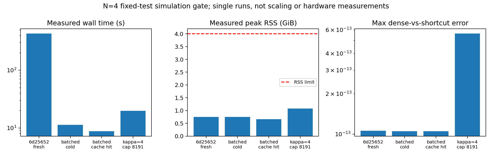

# Phase (b): optimization and correctness gate

2026-10-19; baseline commit `6d25652`. **The optimized N=4 prototype passes
at kappa=2 and kappa=4. Full theorem simulation and full parameter sweeps remain
unready; no sweeps were launched.**

The main bottleneck is reduced by an equivalent batched implementation of the
existing symmetric-QSP recurrence. A verified disk cache saves further repeated
synthesis. These changes do not implement reusable shadows, the composed
sampled solver, or the theorem's delta-dependent oracle accuracy.

The [fidelity audit and implementation estimates](PHASE_B_FIDELITY_AUDIT.md)
cover Theorem F.13 and F83–F104 against the current code. The historical
[plan](PHASE_B_PLAN.md) and [calibration](PHASE_B_CALIBRATION.md) are preserved.

## Measured comparison with 6d25652

All four successful jobs ran sequentially in separate fresh processes under
`caffeinate -i`, using `.venv-qos-ref`. The baseline job executes the exact
prototype retrieved from commit `6d25652` and verifies that its shared source
dependencies are unchanged. Its executed source is archived. No baseline
algorithm was substituted. All jobs use N=D=4, s=2, gamma=.3, delta=.1,
eps_state=.01, eps_BE=1e-4, elementary M=1e8, seed 42.

| Job | kappa | Inverse / FP degree | FP polynomial + phases (s) | Total (s) | Peak RSS (GiB) | Full-state error |
|---|---:|---:|---:|---:|---:|---:|
| Exact 6d25652, rerun | 2 | 181 / 2,265 | 407.545 | 431.672 | 0.748 | 6.2501624e-4 |
| Batched, empty phase cache | 2 | 181 / 2,265 | 4.377 | 11.288 | 0.746 | 6.2501624e-4 |
| Batched, verified disk hits | 2 | 181 / 2,265 | 1.986 | 8.788 | 0.658 | 6.2501624e-4 |
| Batched, explicit cap 8,191 | 4 | 501 / 4,535 | 12.745 | 19.885 | 1.077 | 6.2535986e-4 |

At kappa=2 the measured FP-stage speedup is **93.11x cold** and **205.16x with
disk reuse**. Total runtime ratios are 38.24x and 49.12x. These are single-run
ratios, not a repeated-run benchmark with confidence intervals. In particular,
the baseline rebuilt a Matplotlib font cache: its sparse-oracle/import stage
took 19.912 s versus 3.946 s in the optimized job. Total ratios therefore
include that startup difference; the FP-stage comparison isolates the dominant
optimization much better. No adjusted or extrapolated runtime is presented as
a measurement.

Cold peak RSS changed by only −0.3%, which is too small to claim a meaningful
memory improvement from one sample. The cache-hit job measured 12.1% less peak
RSS than the baseline. RSS is absolute process memory sampled every 50 ms,
not an allocation trace or quantum hardware memory. All runs stayed below
4 GiB and passed available-memory gates. The kappa=4 job reused the D.23 and
inverse phases from earlier jobs; **its FP synthesis was a cache miss**.

The historical calibration in 6d25652 reported 441.543 s / 0.795 GiB, including
413.443 s for FP polynomial/phases. The fresh baseline's 431.672 s / 0.748 GiB
is the primary comparison here; neither historical artifact was overwritten.



Artifacts: [benchmark CSV](artifacts/phase_b_optimization_20261019/benchmark.csv),
[ratios and unchanged-output checks](artifacts/phase_b_optimization_20261019/comparison.json),
[baseline](artifacts/phase_b_optimization_20261019/baseline/result.json),
[cold](artifacts/phase_b_optimization_20261019/cold/result.json),
[warm](artifacts/phase_b_optimization_20261019/warm/result.json),
[kappa=4](artifacts/phase_b_optimization_20261019/kappa4/result.json).
Each job also has a manifest with exact source hashes, reference commit,
dependency versions, platform and measured resource status.

## What changed, and what did not change mathematically

The original pyqsp Jacobian evaluates each Chebyshev node in a Python loop,
with another phase loop and repeated tiny matrix allocations/trigonometric
evaluations. `phase_cache.py` evaluates those same recurrences across all nodes
in arrays and uses the real FFT for the same nonnegative coefficients. Newton
still starts at coefficients/2, uses a dense linear solve, updates before
testing the same residual criterion, and retains the 100-iteration limit.
Nonconvergence is explicitly rejected. At kappa=2 and 4 it converged in 19
iterations with residuals 5.36e-13 and 4.03e-13. Actual Newton-only times were
2.411 s and 9.100 s; the table includes polynomial construction and independent
reference verification as well.

Polynomial target, interpolation/degree search, margin, regularization,
normalization, RNG, sign degree, finite-M primitive settings, full-state
leakage and every existing correctness gate are preserved. The opt-in API is
`calibrate(..., phase_backend='batched', cache_dir=..., max_degree=...)`.
Default calls still use the original upstream backend and cap 4,095.
Neither pyqsp nor the reference repository is patched.

Cache entries store exact coefficients and angles, integrity hashes, tolerances,
reference/dependency identities and synthesis provenance. Every disk hit is
rechecked with the reference circuit on 2,001 nodes to 1e-10. The successful
cold and warm jobs have identical degrees, mean signal, full-state error and
calculated resource dictionaries. This is expected because the scalar/SVD
prediction uses unchanged polynomials; the independent dense-circuit checks
establish that the newly generated phases still implement those polynomials.

## Correctness and the kappa=4 failure diagnosis

| Numerical check | Fresh baseline kappa=2 | Optimized kappa=2 | Optimized kappa=4 |
|---|---:|---:|---:|
| D.23 dense vs SVD | 4.071e-15 | 3.801e-15 | 3.801e-15 |
| Inverse dense vs SVD | 5.093e-14 | 5.062e-14 | 9.401e-14 |
| FP dense vs SVD | 1.059e-13 | 1.051e-13 | 5.629e-13 |
| FP reference response vs polynomial | 1.839e-13 | 1.869e-13 | 3.680e-13 |
| Maximum stage LCU unitarity error | 7.623e-13 | 7.716e-13 | 1.845e-12 |
| Augmented least-squares state vs exact ridge | 3.092e-16 | 3.092e-16 | 3.061e-16 |
| Readout probability vs exact ridge | 2.454e-7 | 2.454e-7 | 2.586e-7 |

All numerical circuit errors remain far below the 1e-9 dense gate; phase
responses pass 1e-10. Dirty-ancilla differences remain order one, as expected
for the negative controls. The predicted label agrees with exact ridge.
Both kappa values choose 17 fixed-test shots, with exact model success about
0.90062; the 200 simulated repetitions are retained in each result. This is
a diagnostic under the fixed-test model, not a theorem-level probability
certificate for sampled oracles or reusable tests.

At kappa=4 the measured condition number is exactly 4, lambda=1/15 and
r_reg=0.117647. The inverse interval error is 1.9374e-5 versus tolerance
3.125e-5. The amplification threshold remains **1/160**, even though the actual
success amplitude is 0.161096. No observed-amplitude shortcut was taken.

The first kappa=4 run retained the original cap 4,095. The search tried degrees
1,179, 1,651, 2,313 and 3,239. At the last candidate its interval error was
1.89751e-5 and grid peak 1.00001898, violating the unchanged tolerances.
The next search candidate, 4,535, exceeded the cap. The retained
[failure manifest](artifacts/phase_b_optimization_20261019/kappa4_cap/manifest.json)
records 7.448 s / 0.703 GiB and no memory violation. FP phase synthesis was
never reached in that failed job.

Allowing 8,191 explicitly admitted the next candidate, 4,535. It has interval
error 3.83367e-7 <=7.8125e-7 and grid peak 0.9999998118, and passes synthesis
and dense checks. Thus this failure was **the imposed cap on the selected
polynomial search**, not failed numerical phase synthesis or evidence of a
mathematical impossibility. It does not prove 4,535 is the minimum degree:
the geometric search skips degrees, including some below 4,095.

## Fidelity decision

The [audit](PHASE_B_FIDELITY_AUDIT.md) distinguishes these outcomes explicitly:

- **Faithful end-to-end theorem simulation: not achieved.** Missing reusable
  Clifford readout, literal controlled-solver/FPAA composition, fresh stochastic
  channels with the correct label shared record, and certified query/error accounting.
- **Partial simulation with analytical accounting: current result.** The
  deterministic stagewise fixed-test chain passes, while its branch recipe is
  still provisional analytical accounting. At kappa=2 it reports 9.49e18 samples
  under its sharing recipe; those samples were not actually drawn. Treating that
  number as measured sample complexity would be wrong.
- **Primitive-level tightness only: established Phase (a) scope.** The present
  solver optimization does not upgrade those findings into F61 exponent results.

The theorem allocates delta/(6Q) to each oracle error contribution after fixing
the full readout/query algorithm. Current eps_BE=1e-4 and M=1e8 are fixed
prototype choices. Changing Hadamard shot counts with delta cannot test the
theorem's delta^-1 oracle penalty. Expected-unitary amplitude errors likewise
do not measure stochastic channel error. The old large-grid timing forecast
does not apply to the optimized backend, but a replacement full-theorem runtime
estimate is still unjustified while the missing algorithms are unspecified.

## Smallest meaningful next experiment and runtime estimate

Recommend approval for **one N=4 reusable-shadow readout correctness gate**,
not a parameter sweep. Fix s=2, kappa=2, gamma=.3, delta=.1, seed 42 and m=4
distinct tests with both signs. Retain one common record set per independently
generated model and evaluate every test from those records. Compare ideal
ridge-state readout with the finite-M stagewise state including its leakage.
The latter needs the clean/garbage flag in the simulated state. Neither is yet
the full sampled-oracle theorem pipeline.

For this tiny dimension, a tractable simulator can enumerate stabilizer states
and sample the exact marginal record distribution. For dimension d, uniform
Clifford measurement induces record v=U†|b> with probability
`d/|S| * <v|rho|v>` over the stabilizer-state set S. This follows because the
Clifford action is transitive and each record has equal multiplicity before
Born weighting. It is a proposal for mathematically equivalent readout
simulation, not an implemented sampler or a scalable quantum algorithm.
Acceptance requires complete enumeration, uniqueness/stabilizer checks,
measurement-channel identity and cross-checks against explicit Clifford
measurement at smaller dimension. A short random circuit is not a substitute.

At three qubits the enumeration has 1,080 states; at four qubits, retaining
the prototype's leakage flag, 36,720. The dense four-qubit state table itself
is about 9 MiB. The shadow record `(d+1)|v><v|−I` and variance bound
`Var <=3 tr(O²)=6` follow from the global-Clifford construction in
[Huang, Kueng and Preskill, Eq. S16 / Proposition 1](https://arxiv.org/pdf/2002.08953).
These facts must be reflected in the sampler tests before the statistical run.

A conservative, explicit readout budget at error epsilon/2=.035355 is
19,201 independent records per block and 17 independent blocks, taking the
median of block means. Chebyshev gives block failure <=1/4 and a binomial tail
plus union bound over four tests gives <=0.04954. Thus **326,417 records per
model** suffice under those assumptions, with no unknown big-O constant in
this proposed readout bound. Correlations across tests from reusing records do
not invalidate the union bound. The current .01 solver error is below the
other epsilon/2 allocation. This does not allocate sampled-oracle error.

To ground the execution estimate, an explicitly labelled
[array-throughput proxy](artifacts/phase_b_optimization_20261019/readout_cost_proxy.json)
timed only weighted-index generation and four-column median-of-means lookup
using synthetic tables, **not Clifford/shadow outcomes**. Five repeats measured
median 0.0373 s and 0.0561 s per model for those two table sizes. Multiplying
by 200 independent validation repetitions gives estimated lookup costs of
7.46 s and 11.22 s; those 200-run costs were not measured. Solver setup was
measured at 8.79 s with cached phases. Enumeration, proof checks, distribution
construction and end-to-end sampled oracles are excluded from the proxy.

For an implemented enumerated readout backend, **2–10 minutes of execution**
is a defensible planning allowance for one such gate, dominated by enumeration
and validation; it is not a measured shadow runtime or a guaranteed upper
bound. Preflight enumeration and 10,000 actual records first, checkpoint, and
stop at ten minutes if the projection fails. Implementation/validation is
estimated at **2–4 engineering days**. Full solver composition plus fresh
sampled channels and accounting is a separate approximately **2–4 week**
scope, detailed in the audit. No part of that new implementation has begun.

## Validation, preservation and reproducibility

All **80 tests passed in 104.46 s**, consisting of the unchanged 67-test suite
and 13 new tests. Tests cover both-parity recurrence equivalence, upstream
Newton phase agreement, independent finite differences, cache identity changes,
corruption including a recomputed checksum, independent response verification,
and rejection of nonconvergence. The test process peaked at 0.857 GiB with no
memory-gate violation. See [test record](artifacts/phase_b_optimization_20261019/tests.json)
and [JUnit XML](artifacts/phase_b_optimization_20261019/tests.xml).

The reference checkout remains clean and pinned. `pip check` in `.venv-qos-ref`
passes; JAX 0.8.1, pyqsp 0.2.0, NumPy 2.3.5 and SciPy 1.16.3 are unchanged.
No shared `src/`, main environment, Bank file, prior result or ledger row is
changed, so the shared-code/Bank rerun trigger does not apply. A preservation
manifest hashes the pre-existing tracked data/results/notebook/shared-source
fixtures and checks their equality. New files, including benchmark artifacts,
are confined to `experiments/qos_tightness/` under this gate's stricter isolation
constraint; the global ledger is left unchanged.

To reproduce without overwriting this run, choose a **new** directory under
`experiments/qos_tightness/artifacts/`, set `PYTHONPATH=experiments/qos_tightness`
and `MPLCONFIGDIR=/tmp/qostight-mpl`, and run with `.venv-qos-ref/bin/python`
under `caffeinate -i`:

```text
-m qostight.run_phase_b_optimization baseline --directory NEW_DIRECTORY
-m qostight.run_phase_b_optimization cold --directory NEW_DIRECTORY
-m qostight.run_phase_b_optimization warm --directory NEW_DIRECTORY
-m qostight.run_phase_b_optimization kappa4_cap --directory NEW_DIRECTORY
-m qostight.run_phase_b_optimization kappa4 --directory NEW_DIRECTORY
```

The capped job is expected to fail and retain its failure artifact. Each job
refuses to overwrite its directory. The runner is deliberately a fixed list
of gate jobs, not a sweep driver. Runtime, RSS, errors, cache provenance and
failures are retained. Work stops here for the user's next approval. No push.
