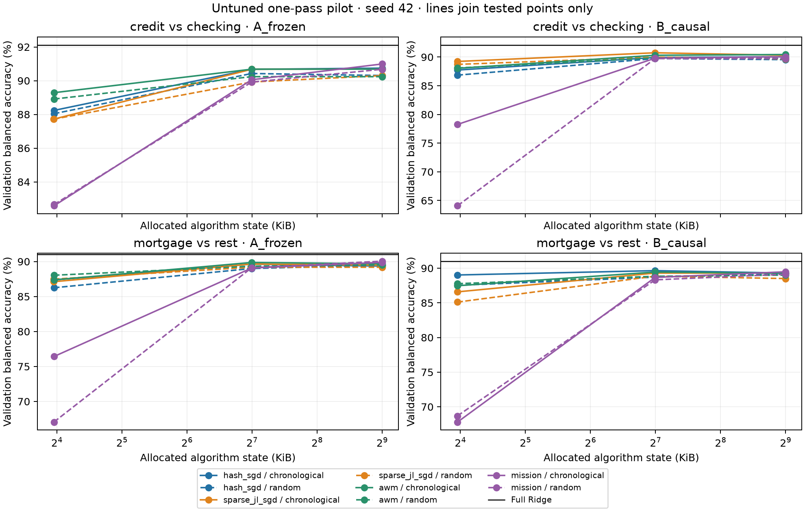

# CFPB classical streaming-state validation pilot

Run `20261019T202457Z-4a8cdd1c`, based on published `13aae4f`. **Completed: 96/96 trajectories, 0 failed, 0 skipped, 0 remaining.** Seed 42; one training pass; validation only. No full benchmark, new-method test evaluation, balanced CFPB model, QOS simulation, or push was performed.

The measured benchmark took **1102.38 seconds (18 min 22 s)**, including frozen-data preparation, reference reproduction, calibration, workers and checkpoint evaluation. It processed **994,752 training presentations** and **1,005,120 validation presentations**. Training occupied 766.85 s and validation 238.17 s. Development, correctness/regression tests and post-run scalar reporting are outside that timer. The one-hour cap was not approached.

The prototype meets the bounded single-pass and measured-state objectives. At the end of one pass, 85/96 configurations cross 95% of full Ridge on **both** ordinary and balanced accuracy, and 33/96 cross 98%. None crosses 99%, including at earlier checkpoints. These are untuned single-seed validation observations, not confirmed retention, method rankings, or estimates of `k_star_grid`.

## Design and algorithm fidelity

The prespecified tasks are near-balanced credit versus checking (7,265 training / 1,588 primary validation rows) and imbalanced mortgage versus rest (13,459 / 3,033). Task choice used the frozen plan and training counts, not test performance. Each task has four methods × two representations × two orders × three algorithm ceilings (16/128/512 KiB). Calibration is the first of those 96 trajectories. Checkpoints reuse each trajectory at ceil(N/8), ceil(N/4), ceil(N/2), N; no training example repeats in a trajectory.

All streaming learners use half squared loss, float64 state, no intercept, no class weights and no averaging. Hashing/JL/AWM use lambda=1/N and eta(t)=0.1/(1+0.1*lambda*t); native MISSION uses lambda=0. Hyperparameters are prespecified diagnostic settings, not validation-tuned winners. Both adaptive methods have fixed-capacity heaps and indices, with every capacity byte charged. There is no hidden full-dimensional gradient/model, observed-feature dictionary, or global heavy-hitter scan.

AWM uses the paper’s projected-tail predictor and median admission/eviction queries; MISSION uses a bounded touched-coordinate candidate heap. The squared-loss AWM adaptation, canonical candidate order, exact MISSION heap priorities, stale untouched estimates, inspected author revisions, and independent implementation provenance are documented in [PROTOCOL.md](../../../experiments/cfpb_streaming_state/PROTOCOL.md). The seeded q=3 sparse projection is a new empirical construction, not a certified JL distortion guarantee or the legacy occupancy-normalized JL. A toy row adapter matches the unchanged legacy function exactly; it adds no real-data trajectory. Dense-gradient/scikit-learn controls also use toy data. No author code was copied or new dependency installed.

**A: frozen-feature replay.** Common-January 50,000-feature float32 TF-IDF values are preserved, then cast to float64. January vocabulary/IDF construction already accessed all 13,459 January rows, including rows outside the pair task. Chronological updates and prefix scores are conditional replay, not prospective within-January preprocessing or an end-to-end prefix sample bound.

**B: causal features on the frozen population.** Document-local normalized term counts, the same tokenization/stop words/ngrams, and fixed 128-bit token identities; no learned vocabulary, DF, IDF, min_df or label-frequency state. B changes the representation, so its gap from the same TF-IDF Ridge target combines representation, optimization and sketch effects. A and B share populations and targets but are not interchangeable feature experiments. Both inherit the frozen population’s offline grouping/selection caveat and assumed immediate label availability.

Random replay uses the same seed-derived permutation across methods and budgets. Its resident int32 order and int64 offset arrays are charged; chronological replay owns no N-sized ordering array. The offline raw-text spools and indices are explicit external disk infrastructure under ignored `data_cache/`. The source export is physically scanned for integrity/extraction, but only approved train/validation rows reach encoders and learners. No test-performance columns were read into reference selection.

## Correctness and preservation

All **211 distinct tests** pass: 25 new correctness/reporting tests, 177 existing fast tests and nine Bank regressions. Tests cover independent projected/adaptive updates, collisions and eviction, fixed allocation, immutable prediction, deterministic state/reader restart, future-partition rejection, legacy projection compatibility and ledger idempotence. `pip check` passes and all pinned versions match. The full Bank sweep was skipped because no shared scientific code, notebook, fixtures or numerical environment changed. Exact commands and the scope/tolerances of Bank numerical checks are in [test_results.json](test_results.json); an unmeasured full-sweep maximum error is not asserted.

Preparation verified frozen text hashes, task membership/order, vocabulary/IDF, and exact row-wise feature equality on all 13,459 January rows. Both tasks’ four Ridge alphas reproduce frozen validation accuracy and balanced accuracy within 1e-12. The largest raw/scaled logit discrepancy is **3.04e-9** and largest normalized normal-equation residual **3.97e-10**. Eight primary Ridge solves and eight algebraic-equivalence solves are separately recorded non-streaming reference work, not extra streaming trajectories.

All 96 saved numerical states are hash-valid, finite, restorable, and consistent with one pass and four evaluation checkpoints. Every measured algorithm state fits its ceiling. All **87 frozen CFPB artifacts, 13 Bank regression artifacts, and 287 pre-existing tracked files** remain unchanged; the ledger is the sole authorized append-only exception. Source CSV and execution-source hashes also match. QOS code, results, phase artifacts and its environment remain untouched.

A post-run checker initially assumed preprocessing object sizes must equal those in a different process. It found a **32-byte** difference for A. An initialization-only diagnostic reproduced Python instance dictionaries of 296/288/280 bytes on successive vectorizer and transformer objects. Fresh workers correctly measured 8,219,927 bytes; shared preparation measured 8,219,895. The checker now verifies exact equality to each worker’s own inventory. No numerical output, trajectory, budget, or measured memory value changed. See [verification.json](verification.json).

## References and calibration

| Task | Full Ridge alpha | Accuracy | Balanced accuracy | Macro-F1 | Majority accuracy |
| --- | --- | --- | --- | --- | --- |
| credit_vs_checking | 1.0 | 92.128% | 92.122% | 92.126% | 50.756% |
| mortgage_vs_rest | 1.0 | 97.923% | 91.013% | 93.793% | 90.076% |

Full Ridge remains unweighted and has no intercept. Alpha selection uses primary validation accuracy, ties to larger alpha. Its coefficient payload is 400,000 bytes and allocated coefficient array is 400,112 bytes; these are non-streaming reference state measurements, not fitting memory or online state. Peak preparation RSS was **521,682,944 bytes (497.52 MiB)**; its three timed stages totaled 8.18 s.

Calibration, credit/checking A hashing chronological at 16 KiB, completed in **3.81 s** including subprocess overhead. Training took **1.661 s**, or **4,373 examples/s**. It used **15,865 algorithm bytes**, **8,245,076 total persistent bytes**, and **195,002,368 peak RSS bytes**. Validation accuracy / balanced accuracy were **88.224% / 88.236%**. Encoder initialization and encoding costs are recorded separately in the trial and summary CSV.

## Measured memory and runtime

All four methods fit all intended ceilings. Across methods/orders/tasks, actual algorithm allocations are **15,854–15,896**, **130,550–130,588**, and **523,766–523,804 bytes** at the three ceilings. These correspond to **1,982–1,987**, **16,319–16,324**, and **65,471–65,476** allocated-byte 64-bit-equivalent registers. Native array register counts are also recorded by dtype; a 128-bit key is two uint64 elements. The 512 KiB algorithms exceed the full Ridge coefficient allocation and are larger-state controls, not coefficient-memory savings.

Preprocessing is **8,219,927 bytes in A** and **47,939 bytes in B**. Total persistent state ranges **8,245,063–8,914,850 bytes in A**, and **73,075–742,862 bytes in B**. Random ordering adds 12N array payload bytes (87,180 for the pair, 161,508 for OVR), array/container overhead, and a separately reported temporary 8N-byte setup permutation. At 16 KiB, A’s vocabulary dominates memory. This is the measured Python implementation’s cost, not an information-theoretic preprocessing lower bound; packed representations could differ.

| Track | Method | Training seconds (12 runs) | Training examples/s range | Peak worker RSS (MiB) |
| --- | --- | --- | --- | --- |
| A_frozen | AWM-Sketch | 131.32 | 858–1086 | 191.09 |
| A_frozen | Hashing + SGD | 30.14 | 3864–4373 | 194.88 |
| A_frozen | MISSION | 142.20 | 836–908 | 193.41 |
| A_frozen | Sparse JL + SGD | 30.83 | 3964–4186 | 193.25 |
| B_causal | AWM-Sketch | 187.51 | 627–709 | 168.33 |
| B_causal | Hashing + SGD | 26.28 | 4589–4838 | 168.84 |
| B_causal | MISSION | 191.87 | 603–683 | 169.28 |
| B_causal | Sparse JL + SGD | 26.70 | 4503–4801 | 169.72 |

These are ranges across the twelve task/order/budget configurations per method/track, not repeated timing trials or seed confidence intervals. Timings include strict per-example state audits and were collected in an interactive work session, not on exclusive benchmark hardware. Training includes reading, encoding and updates; evaluation, startup and checkpoint costs remain separate. Worker RSS includes interpreter/native overhead and is sampled every 50 ms; brief peaks can be missed. Driver RSS is not included in worker RSS. Shared preparation ran in a separate process, so it did not leave a free full dataset in the learner.

Inventories include unused capacity, coefficients, counters, keys, heap/index, projection and optimizer state. Total state is a conservative sum of separately charged components; small immutable objects shared across components may be counted twice. Explicit current-document/validation workspace is a lower-bound inventory, with native/transient effects also reflected in sampled RSS. Inference retains the unpruned learner; no smaller inference export is claimed. A currently stores 128-bit active keys even though smaller frozen indices would suffice—another reason these are prototype footprints, not minimum-memory claims.

## Predictive results

The following common **128 KiB ceiling** compares all methods at equal training access. Values are primary-validation accuracy / balanced accuracy, in percent. All final and prefix results, macro-F1, natural-stream results and strata are in the CSVs and per-trial JSON; no method was dropped.

| Task | Track | Method | Chronological accuracy / BA | Random accuracy / BA |
| --- | --- | --- | --- | --- |
| credit_vs_checking | A_frozen | AWM-Sketch | 90.68 / 90.68 | 90.24 / 90.24 |
| credit_vs_checking | A_frozen | Hashing + SGD | 90.68 / 90.68 | 90.43 / 90.43 |
| credit_vs_checking | A_frozen | MISSION | 90.05 / 90.06 | 89.92 / 89.92 |
| credit_vs_checking | A_frozen | Sparse JL + SGD | 90.68 / 90.68 | 89.92 / 89.92 |
| credit_vs_checking | B_causal | AWM-Sketch | 90.30 / 90.31 | 89.86 / 89.87 |
| credit_vs_checking | B_causal | Hashing + SGD | 89.92 / 89.93 | 89.74 / 89.74 |
| credit_vs_checking | B_causal | MISSION | 89.80 / 89.81 | 89.74 / 89.74 |
| credit_vs_checking | B_causal | Sparse JL + SGD | 90.74 / 90.75 | 89.99 / 89.99 |
| mortgage_vs_rest | A_frozen | AWM-Sketch | 97.73 / 89.87 | 97.56 / 89.33 |
| mortgage_vs_rest | A_frozen | Hashing + SGD | 97.56 / 89.63 | 97.49 / 89.00 |
| mortgage_vs_rest | A_frozen | MISSION | 97.36 / 89.08 | 97.43 / 89.11 |
| mortgage_vs_rest | A_frozen | Sparse JL + SGD | 97.59 / 89.65 | 97.56 / 89.19 |
| mortgage_vs_rest | B_causal | AWM-Sketch | 97.49 / 89.44 | 97.46 / 88.84 |
| mortgage_vs_rest | B_causal | Hashing + SGD | 97.59 / 89.65 | 97.49 / 88.71 |
| mortgage_vs_rest | B_causal | MISSION | 97.16 / 88.67 | 97.07 / 88.32 |
| mortgage_vs_rest | B_causal | Sparse JL + SGD | 97.49 / 89.30 | 97.49 / 88.85 |

Ordering effects are real observations but not across-seed conclusions. Across all budgets/tasks/tracks, random-minus-chronological accuracy ranges **−14.42 to +14.90 percentage points for MISSION**, whose balanced-accuracy range is **−14.18 to +0.88 points**. Other methods have accuracy changes within 0.89 points and balanced-accuracy changes up to 1.50 points. The large small-budget MISSION changes warrant multi-seed validation; they are not evidence of a universally better order. Confusion matrices and class recalls remain available.

For example, causal chronological hashing at 16 KiB on mortgage achieves **97.263% accuracy** (over 99% of Ridge accuracy), but **89.021% balanced accuracy** (about 97.8% of Ridge BA). Accuracy-only retention would overstate the result. The joint safeguard and separately recorded excess-over-majority diagnostic prevent that interpretation.

[Ordinary-accuracy figure](accuracy_vs_state.png). Lines connect tested points only, without monotonicity or uncertainty claims.

## Samples and retention: descriptive only

Earliest observed joint crossings over the approved grid are shown below. This is retrospective inspection of one seed and multiple tested points, not a confidence-supported sample bound. A always requires the full-January supporting preprocessing artifact in addition to the shown learner presentations.

| Task | Track | Retention | Learner presentations | Method / order | Actual algorithm bytes |
| --- | --- | --- | --- | --- | --- |
| credit_vs_checking | A_frozen | 95% | 909 | Sparse JL + SGD / random | 130550 |
| credit_vs_checking | A_frozen | 98% | 3633 | Sparse JL + SGD / chronological | 523766 |
| credit_vs_checking | B_causal | 95% | 1817 | Sparse JL + SGD / chronological | 130550 |
| credit_vs_checking | B_causal | 98% | 7265 | Sparse JL + SGD / chronological | 130550 |
| mortgage_vs_rest | A_frozen | 95% | 6730 | Sparse JL + SGD / chronological | 15854 |
| mortgage_vs_rest | A_frozen | 98% | 6730 | AWM-Sketch / random | 130588 |
| mortgage_vs_rest | B_causal | 95% | 3365 | AWM-Sketch / chronological | 15864 |
| mortgage_vs_rest | B_causal | 98% | 6730 | Hashing + SGD / random | 130553 |

No tested prefix reaches 99% jointly. No across-seed SD/interval, prediction bootstrap, simultaneous confidence band, confirmed test retention, or `k_star_grid` is estimated. Single-pass failures cannot distinguish optimization, representation and memory limitations. The absence of a real-data full-dimensional SGD convergence control and a same-representation batch B control remains explicit; toy update correctness does not supply either. These limitations prohibit memory lower bounds or quantum advantage/disadvantage conclusions.

## Costed next stage — not authorized or launched

The original ten-task proposal requires 2,773,630,720 training presentations and, under its checkpoint policy, 687,029,504 validation presentations. Transferring current method/track rates gives **25.4–29.0 days**, median-rate scenario **27.3 days**, with 47,360 serial launches including continuations. This is a **calculated projection**, not a measured full benchmark or confidence interval. It assumes current Python/q=3 behavior transfers to other tasks, budgets, schedules and multiple passes. New tuning implementations, q=5, bootstrap, analysis and contingencies can increase cost. Budgeting roughly **5–6 weeks** would be more prudent than promising a month; the full grid is not recommended now.

**Smallest meaningful next experiment:** twelve full-dimensional A SGD controls: two tasks × two orders × step sizes {0.1,0.3,1.0}, seed 42, up to five passes, no intercept/weights, lambda=1/N, the existing inverse-time schedule, and the declared six checkpoints through 5N. This costs 621,720 training presentations and 188,460 validation presentations. Repeated chronological passes must be labeled replay. Current A hashing rates give a proxy of **3.1–3.6 minutes**; propose a **10-minute cap** including overhead. This needs a separate approved implementation extension, not an invocation of the current one-pass driver. Its purpose is to establish whether a suitable optimizer approaches Ridge before attributing gaps to memory. If it fails, revise optimization/tuning prospectively; do not declare more memory necessary.

**Conditional reduced final grid:** retain both tasks, all four methods, A/B, both orders, compressed ceilings **16/64/128 KiB**, and evaluation seeds **[42,123,456,789,2026]**. Retain the plan’s strong equal-access search: 24 prespecified candidates through 5N, four continuations to 10N, those four on a second tuning stream, and five selected evaluation seeds through 10N. This is **3,168 distinct training trajectories plus 384 continuation launches**, 228,792,960 training presentations. The 64 KiB point is unmeasured; using observed within-cell cost ranges gives **51.4–55.8 hours**, median scenario **52.9 hours**, before bootstrap and new-method overhead. Plan **3–4 days** if approved. This reduces tasks and budgets while retaining tuning strength and all competitors. Above-grid 99% failures would remain valid results; no automatic budget expansion.

Before any final test evaluation, freeze the validation-selected configurations and thresholds. Use the planned five-seed summaries, paired group/seed bootstrap and simultaneous frontier bands, with a calendar-day sensitivity and explicit limited-seed caveat. Report accuracy, balanced accuracy and macro-F1 separately, joint headline retention, total state and all adaptive tuning costs. Never reselect minimum memory on test. Stop on correctness/hash/resource failure, widespread divergence, unresolved optimizer convergence, or the approved time/storage cap. The exact reduced grid and hyperparameter table require review before implementation.

## Outputs and stopping point

[trajectory_summary.csv](trajectory_summary.csv) has all 96 statuses and requested measurements; [checkpoint_metrics.csv](checkpoint_metrics.csv) holds sample curves; [state_inventory.csv](state_inventory.csv) exposes allocation/dtype accounting; [cost_ledger.csv](cost_ledger.csv) separates preparation/training/evaluation; [order_differences.csv](order_differences.csv) and [descriptive_retention_crossings.csv](descriptive_retention_crossings.csv) expose exploratory comparisons. Runtime extrapolations are in [full_matrix_runtime_projection.csv](full_matrix_runtime_projection.csv) and [next_stage_projection.json](next_stage_projection.json). The [implementation README](../../../experiments/cfpb_streaming_state/README.md) defines schema, resume behavior, accounting caveats and commands.

Completed scientific work is committed locally after audit. The experiment ledger receives only completed trajectories’ three primary-validation metrics, with unique IDs and byte-for-byte preservation of its original prefix. Raw spools, indices and model resume files remain ignored local artifacts; no raw narrative or model cache is staged. **Stop here for review. No further benchmark, QOS work or GitHub push is authorized by this report.**
